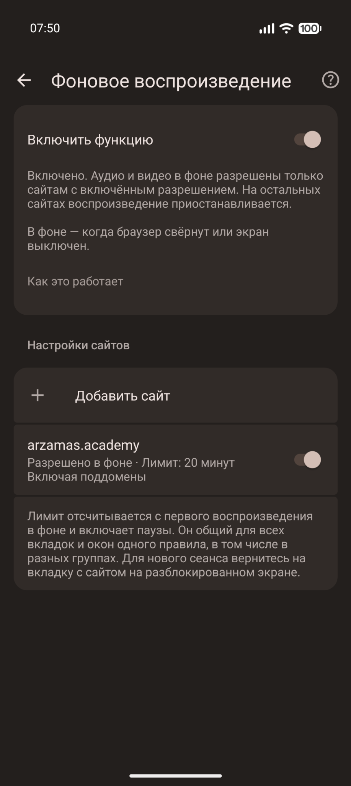
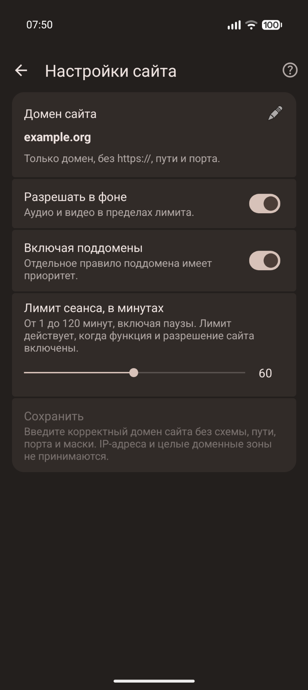
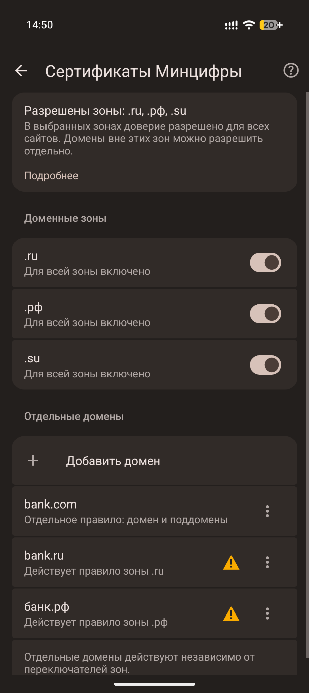
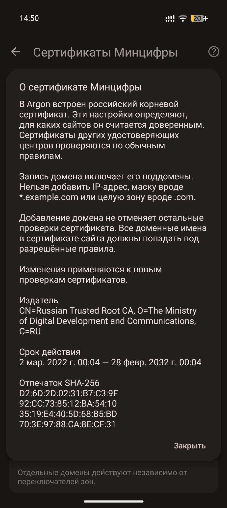
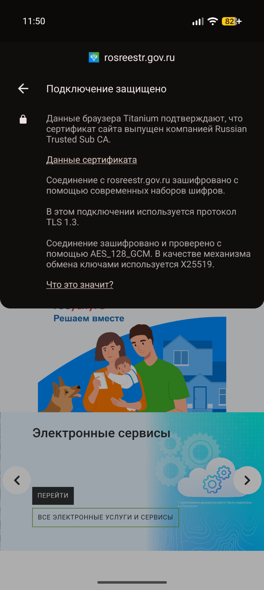
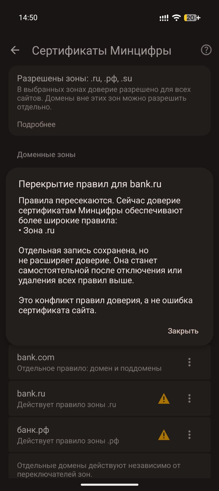
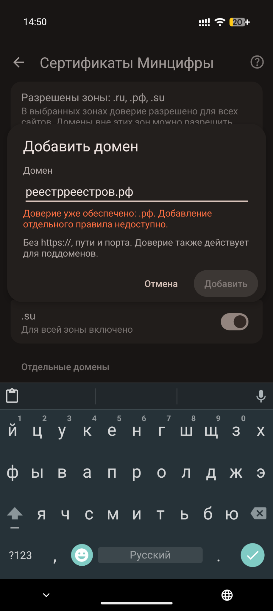
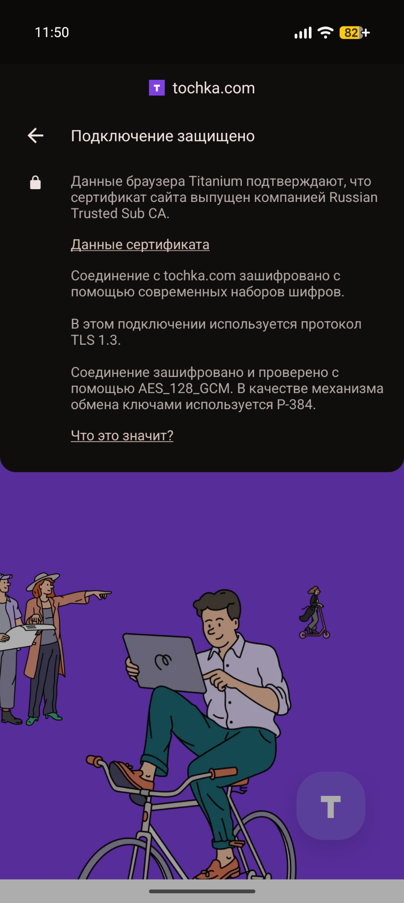
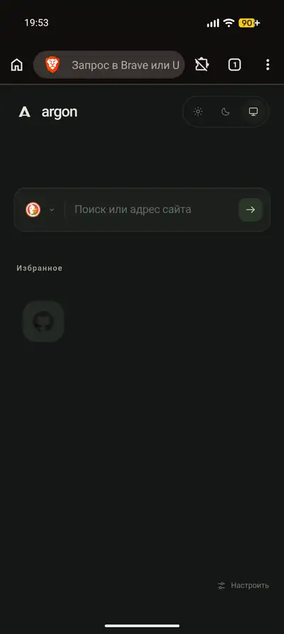
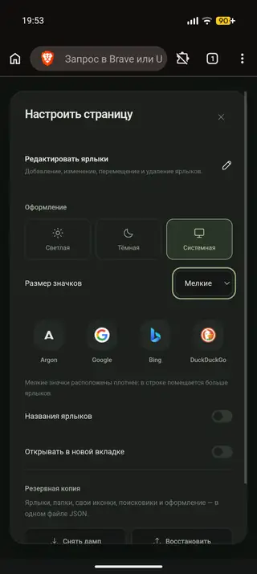

# Argon

Android-браузер на базе Titanium и Chromium с расширениями Chrome, фоновым воспроизведением и поддержкой сайтов, использующих российский корневой сертификат.

**[Скачать последнюю версию](https://github.com/Loopfade/argon/releases/latest)** · [Обсуждение на 4PDA](https://4pda.to/forum/index.php?showtopic=1127809) · [Сообщить об ошибке](https://github.com/Loopfade/argon/issues/new/choose)

## Возможности

- **Расширения Chrome на Android.** Устанавливайте из Chrome Web Store блокировщики рекламы, переводчики и другие дополнения прямо на телефон. Chrome для Android не поддерживает их запуск. Argon также поддерживает Manifest V2 — старый формат расширений, от которого [Google Chrome отказался](https://developer.chrome.com/docs/extensions/develop/migrate/mv2-deprecation-timeline).
- **Фоновое воспроизведение для выбранных сайтов.** Когда браузер свёрнут или экран выключен, воспроизведение аудио и видео продолжается только на сайтах, которым вы дали разрешение в настройках. Для каждого сайта можно отдельно настроить разрешение, поддомены и лимит времени.
- **Очистка при выходе.** Команда «Выход» закрывает все окна браузера и удаляет выбранные данные. Можно настроить категории очистки; если она прервётся, браузер завершит её при следующем запуске.
- **Российские сертификаты для `.ru`, `.рф` и `.su` без установки в Android.** Для этих зон, например `rosreestr.gov.ru`, доверие к встроенному российскому корневому УЦ уже разрешено. Его сертификат входит в Argon, поэтому вручную добавлять его в системное хранилище устройства не требуется.
- **Доверие для выбранных сайтов в других зонах.** Добавьте нужный домен, например `example.com`, в **Сертификаты Минцифры**, чтобы разрешить использование сертификатов этого УЦ для выбранного сайта и его поддоменов, например `www.example.com`. Так можно пользоваться нужными сайтами, сохраняя ограничение доверия к этому УЦ для остальных доменов.

Интерфейс приложения доступен только на **русском и английском языках**. При другом языке системы используется английский.

## Скачать и установить

Для текущих сборок требуется **Android 10 или новее** и устройство с ARM-процессором.

1. Откройте [последний релиз](https://github.com/Loopfade/argon/releases/latest) и разверните список **Assets**.
2. Выберите APK для своего устройства:

| Файл APK | Для какого устройства |
| --- | --- |
| `…-release-arm64-v8a.apk` | Устройства с 64-битной версией Android — большинство современных телефонов |
| `…-release-armeabi-v7a.apk` | Устройства с 32-битной версией Android на ARM |

3. Откройте скачанный APK. Если Android запросит разрешение на установку из этого источника, предоставьте его и завершите установку.

Для обновления скачайте APK нового релиза для той же архитектуры и установите его поверх текущей версии. Рядом с каждым APK опубликован файл `.sha256` для проверки целостности загрузки.

## Расширения

Откройте один из магазинов в Argon, найдите расширение и подтвердите его установку:

- [Chrome Web Store](https://chromewebstore.google.com/) — рекомендуемый источник; версия сайта для компьютера включается автоматически.
- [Opera Add-ons](https://addons.opera.com/).
- [Microsoft Edge Add-ons](https://microsoftedge.microsoft.com/addons/).

Управлять установленными расширениями можно на странице `chrome://extensions`. Там же можно включить режим разработчика и загрузить распакованное расширение из папки.

Локальные файлы CRX и ZIP можно установить через страницу настроек встроенного [Titanium Extension for Android](https://github.com/jqssun/android-titanium-extension). Оно также предоставляет дополнительные настройки, включая внешний менеджер загрузок и расширенный тёмный режим.

Расширения Manifest V2 больше не доступны в Chrome Web Store. Для них используйте загрузку распакованного расширения, полученного от его разработчика.

Для работы расширения в режиме инкогнито откройте его сведения и включите соответствующее разрешение. Совместимость конкретного расширения с мобильным интерфейсом может различаться.

## Фоновое воспроизведение

Argon позволяет воспроизводить аудио и видео на выбранных HTTPS-сайтах в обычных вкладках, когда браузер свёрнут или экран выключен. По умолчанию функция выключена, а список сайтов пуст.

Откройте **Настройки → Фоновое воспроизведение** и включите **Включить функцию**. Аудио и видео в фоне разрешены только на сайтах с включённым разрешением. На остальных сайтах воспроизведение приостанавливается.

Верхняя карточка показывает текущее состояние функции. Нажмите **Как это работает**, чтобы прочитать правила разрешений, приоритет поддоменов и порядок отсчёта времени.

<table>
  <tr>
    <td align="center"></td>
    <td align="center"></td>
  </tr>
  <tr>
    <td align="center"><strong>Общий экран.</strong> Включение функции и список сайтов с отдельными разрешениями и лимитами.</td>
    <td align="center"><strong>Настройки сайта.</strong> Разрешение фонового воспроизведения, область действия и лимит сеанса.</td>
  </tr>
</table>

### Добавление сайтов

1. В разделе **Настройки сайтов** нажмите **Добавить сайт**.
2. Откройте карточку **Домен сайта** и введите имя сайта без `https://`, пути, порта и маски.
3. Настройте переключатели **Разрешать в фоне** и **Включая поддомены**.
4. Задайте **Лимит сеанса, в минутах** от **1 до 120** и нажмите **Сохранить**.

У нового правила разрешение и поддомены включены по умолчанию, а лимит составляет **60 минут**. Поддерживаются домены на кириллице. IP-адреса, целые доменные зоны и точные дубликаты добавлять нельзя. При недопустимом вводе под кнопкой появляется пояснение, а **Сохранить** недоступно.

### Разрешения и поддомены

Нажмите на сайт в списке, чтобы изменить его настройки. Переключатель рядом с сайтом сразу меняет разрешение, сохраняя остальные параметры. Чтобы удалить запись, откройте её настройки, нажмите **Удалить правило** и подтвердите действие.

Переключатель **Включая поддомены** распространяет правило на поддомены сайта. Для отдельного поддомена можно задать своё разрешение и лимит. Если правила пересекаются, действует наиболее конкретное: выключенное разрешение поддомена запрещает воспроизведение в фоне, даже когда более широкое правило его разрешает.

Выключение функции сохраняет список и настройки сайтов, но приостанавливает воспроизведение в фоне. После включения сохранённые разрешения снова действуют; приостановленное воспроизведение нужно возобновить самостоятельно.

### Лимит сеанса

Отсчёт начинается с первого воспроизведения в фоне и включает паузы. Лимит общий для всех вкладок и окон, использующих одно правило, в том числе в разных группах. По истечении времени воспроизведение приостанавливается.

Для нового сеанса вернитесь на вкладку с сайтом на разблокированном экране. Простое включение экрана, перезагрузка страницы или смена видео не обновляют лимит. Возврат на вкладку сам по себе не запускает приостановленное воспроизведение.

## Российские сертификаты

По умолчанию Argon доверяет встроенному российскому корневому удостоверяющему центру для сайтов в зонах **`.ru`, `.рф` и `.su`**. У каждой зоны есть отдельный переключатель: её можно выключить, сохранив запись на экране. Для выбранных доменов доверие можно разрешить отдельно в настройках.

Откройте **Настройки → Конфиденциальность и безопасность → Сертификаты Минцифры**.

Верхняя карточка показывает текущее состояние: включённые зоны, доверие только выбранным доменам или полное отключение. Нажмите **Подробнее**, чтобы прочитать правила проверки, посмотреть издателя, срок действия и отпечаток SHA-256 встроенного корневого сертификата. Эти сведения читаются из самого сертификата.

<table>
  <tr>
    <td align="center"></td>
    <td align="center"></td>
  </tr>
  <tr>
    <td align="center"><strong>Зоны и отдельные домены.</strong> На снимке включены все три зоны. Для <code>bank.com</code> действует отдельное правило, а записи <code>bank.ru</code> и <code>банк.рф</code> уже покрыты правилами зон.</td>
    <td align="center"><strong>Справка о сертификате.</strong> Здесь собраны ограничения для доменов, правила проверки, издатель, срок действия и отпечаток SHA-256 встроенного корневого сертификата.</td>
  </tr>
</table>

Чтобы вести только свой список, выключите все встроенные зоны и добавьте нужные домены. Если все зоны выключены и список пуст, доверие к этому УЦ полностью отключено. Это также действует, если тот же корневой сертификат установлен в Android. Сертификаты других доверенных УЦ проверяются по обычным правилам.

<table>
  <tr>
    <td align="center"></td>
  </tr>
  <tr>
    <td align="center">rosreestr.gov.ru — пример сайта в зоне .ru</td>
  </tr>
</table>

### Пересечения правил доверия

Новый домен нельзя добавить, если его уже покрывает включённая зона или существующая запись. Например, при включённой `.ru` нельзя добавить `bank.ru`, а запись `example.com` уже покрывает `www.example.com`.

Если сначала добавить `bank.ru` при выключенной `.ru`, а затем включить зону, запись останется в списке. То же происходит, когда сохранённую запись начинает покрывать добавленный родительский домен: записи не удаляются автоматически.

У покрытых записей появляется **жёлтый треугольник с восклицательным знаком**. Под доменом указано, какое более широкое правило обеспечивает доверие. У остальных записей подпись сообщает, что действует отдельное правило для домена и его поддоменов.

Нажмите значок **!**, чтобы увидеть все покрывающие правила и пояснение. Пока включена `.ru`, отдельная запись `bank.ru` не расширяет область доверия. После выключения или удаления всех покрывающих правил значок исчезнет, а сохранённая запись будет обеспечивать доверие самостоятельно.

<table>
  <tr>
    <td align="center"></td>
  </tr>
  <tr>
    <td align="center">Диалог по значку <strong>!</strong> показывает, что доверие для <code>bank.ru</code> уже обеспечивает зона <code>.ru</code>. Отдельная запись сохранена; предупреждение относится к пересечению правил доверия.</td>
  </tr>
</table>

При удалении покрытой записи Argon показывает, какие правила сохранят доверие. Например, после удаления `bank.ru` при включённой `.ru` доверие к этому УЦ для домена и его поддоменов сохранится через правило зоны.

### Добавление доменов

1. В разделе **Сертификаты Минцифры → Отдельные домены** нажмите **Добавить домен** над списком.
2. Введите имя сайта, например `example.com` или `пример.рф`, без `https://`, пути и порта.
3. Нажмите **Добавить**. Если запись недопустима, под полем появляется пояснение, а кнопка недоступна.

<table>
  <tr>
    <td align="center"></td>
  </tr>
  <tr>
    <td align="center">Включённая зона <code>.рф</code> уже обеспечивает доверие для домена и его поддоменов. Под полем показана причина, а кнопка <strong>Добавить</strong> недоступна, поскольку отдельное правило не требуется.</td>
  </tr>
</table>

Кириллические имена показываются в читаемом виде с проверками Chromium на подмену символов. Техническая запись Punycode доступна в сведениях о домене; для хранения и проверки продолжает использоваться нормализованное имя.

Запись разрешает доверие этому УЦ для указанного домена и его поддоменов. Например, `example.com` также охватывает `www.example.com`. Изменения применяются к новым проверкам сертификатов.

На скриншоте ниже показано защищённое соединение с сайтом, домен которого добавлен пользователем. Этот домен не входит во встроенный список.

<table>
  <tr>
    <td align="center"></td>
  </tr>
  <tr>
    <td align="center">Соединение с добавленным доменом</td>
  </tr>
</table>

Нажатие на домен открывает сведения о действующих правилах. Чтобы удалить запись, откройте меню **⋮ → Удалить** рядом с ней и подтвердите действие. IP-адреса, подстановки вроде `*.example.com` и публичные суффиксы вроде `.com` добавлять нельзя. Добавление домена не отключает остальные проверки сертификата.

Проверяются все доменные имена внутри сертификата: если он содержит разрешённый и неразрешённый домены, доверие отклоняется. Это может потребовать дополнительных записей при использовании узкого списка.

## Домашняя страница

Вместо стандартной страницы новой вкладки Argon открывает собственную домашнюю страницу `chrome://argon/`. На ней можно искать в интернете, переходить на сохранённые сайты и организовывать избранное. Страница встроена в браузер и доступна без подключения к сети; для поиска и открытия сайтов нужен интернет. В режиме инкогнито остаётся стандартная приватная страница Chromium.

- **Поиск и адреса.** В строке можно выбрать Google, Bing, DuckDuckGo, DuckDuckGo NoAI или добавить свой поисковик. Введённый адрес открывается как сайт, а текстовый запрос отправляется выбранному поисковику.
- **Избранное.** Добавляйте ярлыки сайтов и папки, задавайте названия и собственные иконки. Через **Настроить → Редактировать ярлыки** можно изменять, удалять и перемещать элементы, в том числе переносить сайты в папки.
- **Оформление.** Доступны светлая, тёмная, AMOLED и «Как в браузере». Последний режим следует настройкам Argon, включая AMOLED при тёмной теме системы; ручной выбор домашней страницы сохраняется отдельно. В настройках можно выбрать крупные или мелкие значки с предварительным просмотром, показать или скрыть названия ярлыков и настроить открытие сайтов в новой вкладке.
- **Резервная копия.** Кнопки **Снять дамп** и **Восстановить** позволяют сохранить настройки домашней страницы в JSON-файл и восстановить их позже. Ярлыки, папки, свои иконки, поисковики и оформление сохраняются в профиле браузера.

<table>
  <tr>
    <td align="center"></td>
    <td align="center"></td>
  </tr>
  <tr>
    <td align="center"><strong>Домашняя страница.</strong> Поиск, избранное и быстрый доступ к настройкам.</td>
    <td align="center"><strong>Настройка страницы.</strong> Ярлыки, тема, размер значков и резервная копия.</td>
  </tr>
</table>

## Помощь и обратная связь

Нашли проблему? [Создайте issue](https://github.com/Loopfade/argon/issues/new/choose) и укажите версию Argon, версию Android, модель устройства и шаги для повторения ошибки.

## О проекте

Argon основан на [Titanium](https://github.com/jqssun/android-titanium-browser) и [Chromium](https://www.chromium.org/). Поддержка российского сертификата адаптирована из [Ruthenium for Android](https://github.com/rutheniumteam/ruthenium-android).

В **Настройки → О браузере Argon** (на английском — **About Argon**) есть описание форка и ссылки на исходный код Argon, сообщения об ошибках и исходный проект Titanium. На том же экране доступны версия приложения, версия Android и юридическая информация.

[Лицензия Argon](https://github.com/Loopfade/argon/blob/main/LICENSE) · [Лицензия Ruthenium](https://github.com/Loopfade/argon/blob/main/licenses/Ruthenium-BSD-3-Clause.txt) · [Лицензия Bare](licenses/Bare-BSD-3-Clause.txt) · [Сборка и проверки](https://github.com/Loopfade/argon/blob/main/VALIDATION.md) · [Полная ручная сборка](docs/build-pipeline.md)

