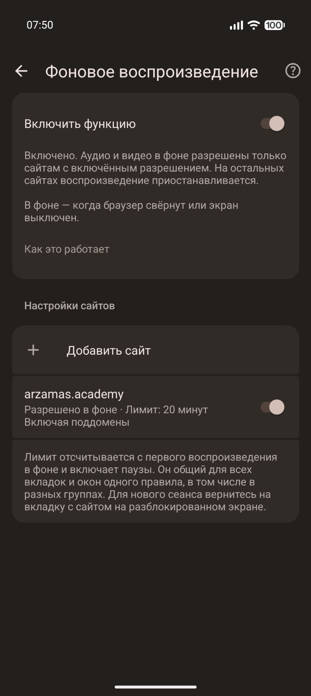
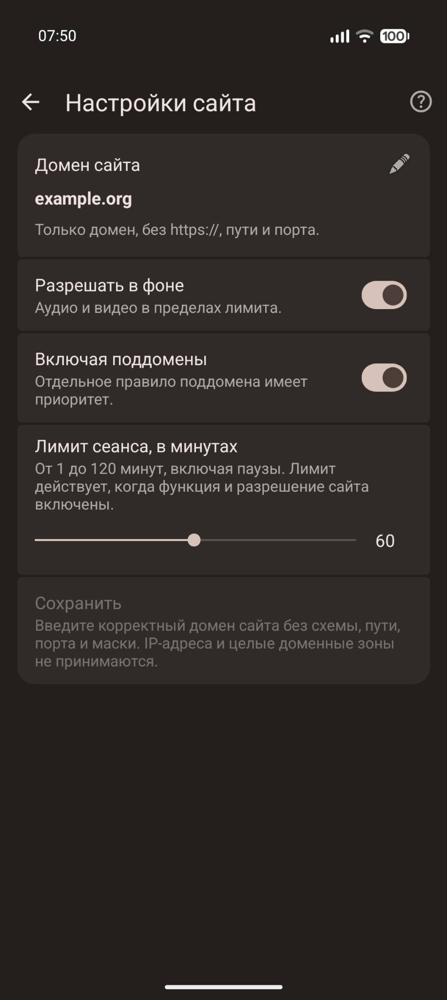
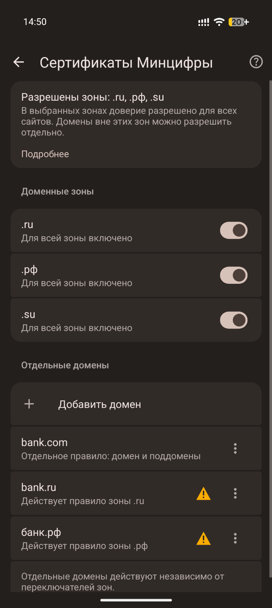
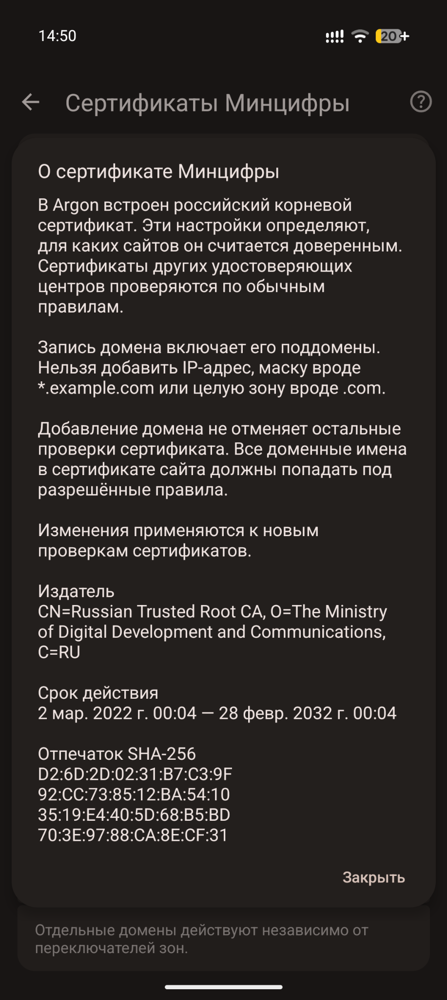
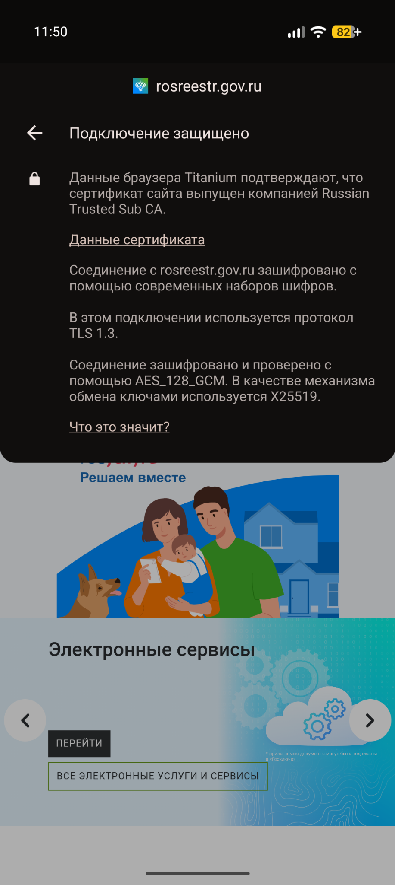
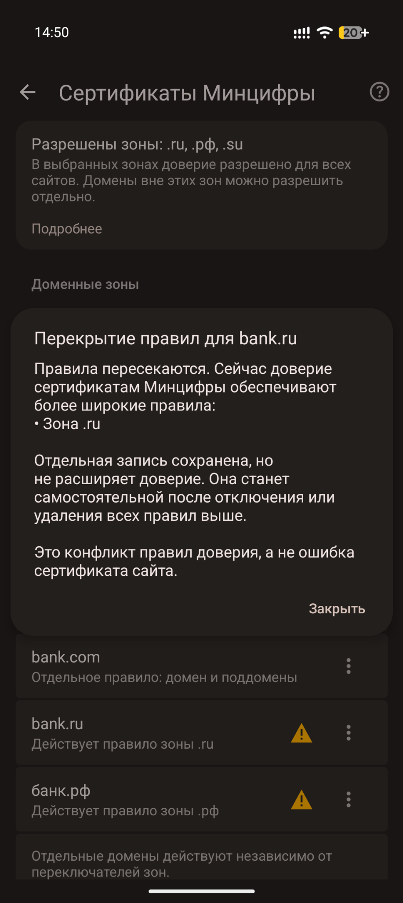
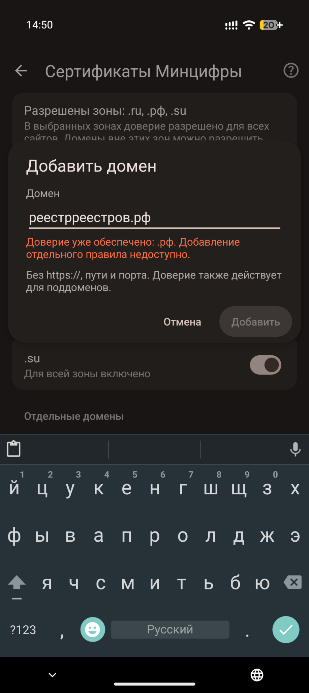
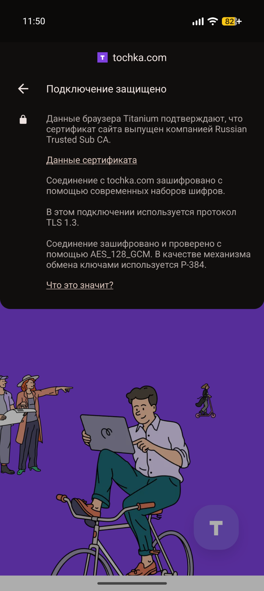
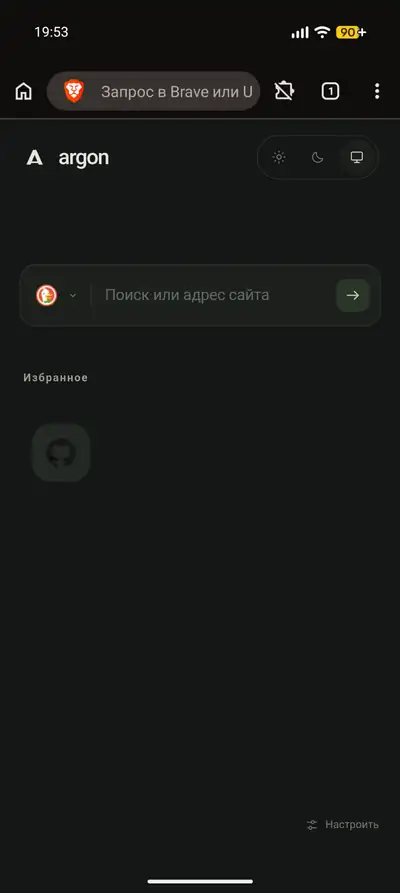
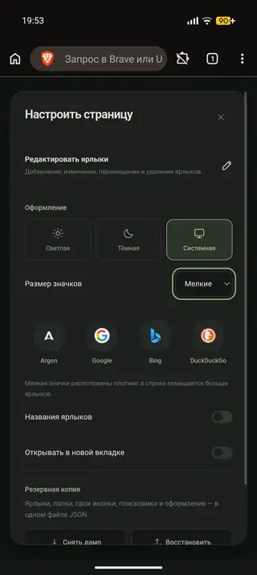

# Argon

Argon — браузер с открытым исходным кодом для Android, форк Titanium на базе Chromium. В нём можно устанавливать расширения Chrome, настраивать домашнюю страницу, разрешать фоновое воспроизведение отдельным сайтам и очищать выбранные данные при выходе.

**[Скачать последнюю версию](https://github.com/Loopfade/argon/releases/latest)** · [Обсуждение на 4PDA](https://4pda.to/forum/index.php?showtopic=1127809) · [Сообщить об ошибке](https://github.com/Loopfade/argon/issues/new/choose)

## Возможности

### Что Argon получил от Titanium

- **Расширения Chrome на Android.** Поддерживаются Manifest V2 и V3, установка из магазинов и загрузка локальных расширений.
- **Chromium с доработками Vanadium.** Titanium применяет патчи проекта Vanadium от GrapheneOS и предоставляет настройки приватности, включая политику использования IP-адресов в WebRTC.
- **Titanium Extension for Android.** Встроенное расширение позволяет настроить затемнение сайтов и передавать загрузки внешнему менеджеру.

### Что добавляет Argon

- **Домашняя страница.** Штатные закладки и папки, свои иконки, поисковики, фон, резервная копия и импорт закладок.
- **Фоновое воспроизведение.** Разрешения для HTTPS-сайтов и поддоменов с лимитом от 1 до 120 минут.
- **Очистка при выходе.** Удаление выбранных данных обычного профиля при завершении работы браузера.
- **Управление доверием к сертификатам Минцифры.** Встроенный корневой сертификат и правила для зон .ru, .рф и .su и отдельных доменов.
- **User-Agent.** Штатный Chrome, строки Firefox и Яндекса или своя строка; режим версии для ПК настраивается отдельно.
- **Оформление.** Тёмная AMOLED-тема браузера и домашней страницы, отдельная настройка чёрного фона при затемнении сайтов.

Интерфейс доступен на русском и английском. Для других языков системы используется английский.

## Скачать и установить

Для текущих сборок требуется **Android 10 или новее** и устройство с ARM-процессором.

1. Откройте [последний релиз](https://github.com/Loopfade/argon/releases/latest) и разверните список **Assets**.
2. Выберите APK для своего устройства:

| Файл APK | Для какого устройства |
| --- | --- |
| `…-release-arm64-v8a.apk` | Устройства с 64-битной версией Android — большинство современных телефонов |
| `…-release-armeabi-v7a.apk` | Устройства с 32-битной версией Android на ARM |

3. Откройте скачанный APK. Если Android запросит разрешение на установку из этого источника, предоставьте его и завершите установку.

Для обновления скачайте APK нового релиза для той же архитектуры и установите его поверх текущей версии. Рядом с каждым APK опубликован файл `.sha256` для проверки целостности загрузки.

## Настройка и использование функций Argon

- [Расширения](#расширения)
- [Фоновое воспроизведение](#фоновое-воспроизведение)
- [Открытие ссылок в приложениях](#открытие-ссылок-в-приложениях)
- [User-Agent](#user-agent)
- [Российские сертификаты](#российские-сертификаты)
- [Домашняя страница](#домашняя-страница)
- [Очистка при выходе](#очистка-при-выходе)

### Расширения

Откройте один из магазинов в Argon, найдите расширение и подтвердите его установку:

- [Chrome Web Store](https://chromewebstore.google.com/) — рекомендуемый источник; версия сайта для компьютера включается автоматически.
- [Opera Add-ons](https://addons.opera.com/).
- [Microsoft Edge Add-ons](https://microsoftedge.microsoft.com/addons/).

Управлять установленными расширениями можно на странице `chrome://extensions`. Там же можно включить режим разработчика и загрузить распакованное расширение из папки.

Локальные файлы CRX и ZIP можно установить через страницу настроек встроенного [Titanium Extension for Android](https://github.com/jqssun/android-titanium-extension). Оно также предоставляет дополнительные настройки, включая внешний менеджер загрузок и расширенный тёмный режим.

Чтобы открыть эти настройки, выберите **Titanium** в меню расширений и нажмите **Options** в его всплывающем окне. Расширение также можно найти на странице `chrome://extensions`. Окно **Настроить страницу** на главной отвечает за оформление и данные главной; настройки расширений открываются отдельно.

Расширения Manifest V2 больше не доступны в Chrome Web Store. Для них используйте загрузку распакованного расширения, полученного от его разработчика.

Для работы расширения в режиме инкогнито откройте его сведения и включите соответствующее разрешение. Совместимость конкретного расширения с мобильным интерфейсом может различаться.

### Открытие ссылок в приложениях

Откройте **Настройки → Открытие ссылок в приложениях** и выберите режим:

- **Разрешать** — обычные правила браузера; этот режим выбран по умолчанию.
- **Только для сайтов из списка** — открывать приложения только для ссылок на добавленные сайты и их поддомены. При пустом списке переходы в приложения запрещены.
- **Запрещать** — оставлять веб-ссылки в Argon и блокировать ссылки, которым требуется другое приложение.

Список сайтов пользователь собирает сам. Нажмите **Добавить сайт**, введите домен или вставьте веб-ссылку, проверьте показанный домен и нажмите **Добавить в список**. Правило действует на все страницы этого домена и его поддомены; отдельные страницы не настраиваются. Нажатие на добавленный сайт открывает подтверждение удаления. При смене режима список сохраняется.

Проверяется адрес назначения, в том числе после перенаправлений. Ссылки без веб-адреса, например ссылки только для приложения, разрешены лишь в режиме **Разрешать**. Если у заблокированной ссылки есть веб-версия, она откроется в Argon; иначе текущая страница останется открытой и появится сообщение о запрете. Настройка действует в обычных вкладках, инкогнито и вкладках Argon, открытых другими приложениями.

Подробности реализации и проверок описаны в [docs/external-navigation.md](docs/external-navigation.md).

### Фоновое воспроизведение

Argon позволяет воспроизводить аудио и видео на выбранных HTTPS-сайтах в обычных вкладках, когда браузер свёрнут или экран выключен. По умолчанию функция выключена, а список сайтов пуст.

Откройте **Настройки → Фоновое воспроизведение** и включите **Включить функцию**. Аудио и видео в фоне разрешены только на сайтах с включённым разрешением. На остальных сайтах воспроизведение приостанавливается.

Верхняя карточка показывает текущее состояние функции. Нажмите **Как это работает**, чтобы прочитать правила разрешений, приоритет поддоменов и порядок отсчёта времени.

<table>
  <tr>
    <td align="center"></td>
    <td align="center"></td>
  </tr>
  <tr>
    <td align="center"><strong>Общий экран.</strong> Включение функции и список сайтов с отдельными разрешениями и лимитами.</td>
    <td align="center"><strong>Настройки сайта.</strong> Разрешение фонового воспроизведения, область действия и лимит сеанса.</td>
  </tr>
</table>

#### Добавление сайтов

1. В разделе **Настройки сайтов** нажмите **Добавить сайт**.
2. Откройте карточку **Домен сайта** и введите имя сайта без `https://`, пути, порта и маски.
3. Настройте переключатели **Разрешать в фоне** и **Включая поддомены**.
4. Задайте **Лимит сеанса, в минутах** от **1 до 120** и нажмите **Сохранить**.

У нового правила разрешение и поддомены включены по умолчанию, а лимит составляет **60 минут**. Можно сохранить до **100 правил для сайтов**. Поддерживаются домены на кириллице. IP-адреса, целые доменные зоны и точные дубликаты добавлять нельзя. При недопустимом вводе под кнопкой появляется пояснение, а **Сохранить** недоступно.

#### Разрешения и поддомены

Нажмите на сайт в списке, чтобы изменить его настройки. Переключатель рядом с сайтом сразу меняет разрешение, сохраняя остальные параметры. Чтобы удалить запись, откройте её настройки, нажмите **Удалить правило** и подтвердите действие.

Переключатель **Включая поддомены** распространяет правило на поддомены сайта. Для отдельного поддомена можно задать своё разрешение и лимит. При пересечении действует более конкретное правило. Например, выключите **Разрешать в фоне** для `youtube.com`, оставьте **Включая поддомены** и добавьте разрешение для `music.youtube.com` с лимитом 60 минут. Тогда YouTube Music сможет играть в фоне, а на остальных адресах под правилом `youtube.com` будет действовать запрет. Подпись **Пересечений: 1** сообщает, что правило пересекается с одним другим правилом.

Выключение функции сохраняет список и настройки сайтов, но приостанавливает воспроизведение в фоне. После включения сохранённые разрешения снова действуют; приостановленное воспроизведение нужно возобновить самостоятельно.

#### Лимит сеанса

Отсчёт начинается с первого воспроизведения в фоне и включает паузы. Лимит общий для всех вкладок и окон, использующих одно правило, в том числе в разных группах. По истечении времени воспроизведение приостанавливается.

Для нового сеанса вернитесь на вкладку с сайтом на разблокированном экране. Простое включение экрана, перезагрузка страницы или смена видео не обновляют лимит. Возврат на вкладку сам по себе не запускает приостановленное воспроизведение.

### User-Agent

Откройте **Настройки → Конфиденциальность и безопасность → User-Agent**. Доступны **По умолчанию (Chrome)**, **Firefox**, **Яндекс Браузер** и **Свой User-Agent**. Режим по умолчанию использует штатную строку и Client Hints Chromium с политикой приватности сборки.

Выбор сохраняется сразу, но начинает действовать после **перезапуска браузера**. До него все вкладки и фоновые обработчики продолжают использовать действующий вариант. Настройки показывают действующий и сохранённый варианты. В диалоге можно нажать **Перезапустить**, **Позже** или **Отменить изменение**. Если отложить применение, кнопка **Применить User-Agent** останется в настройках. Перед перезапуском сохраните введённый на сайтах текст.

**Версия для ПК** продолжает переключаться сразу, без перезапуска: она выбирает мобильную или настольную строку действующего семейства и режим отображения страницы. Смена семейства User-Agent не меняет глобальную настройку версии для ПК и исключения сайтов. Варианты из старых версий автоматически сопоставляются с семейством браузера; сохранённые настройки сайтов остаются на месте.

Своя строка используется и в мобильном, и в настольном режиме. Допускается до 1024 печатных символов ASCII; пустая строка и переводы строк не принимаются. Отмена ввода ничего не сохраняет. Повторный выбор уже действующего значения не требует перезапуска.

Строки Firefox и Яндекса предназначены для совместимости с сайтами. Движок остаётся Chromium, другие свойства браузера могут его идентифицировать. Эти варианты и своя строка не отправляют HTTP-заголовки UA Client Hints. Функция не обеспечивает анонимность или полную эмуляцию другого браузера.

Сценарии проверки и границы автоматических тестов описаны в [docs/user-agent.md](docs/user-agent.md).

### Российские сертификаты

По умолчанию Argon доверяет встроенному российскому корневому удостоверяющему центру для сайтов в зонах **`.ru`, `.рф` и `.su`**. У каждой зоны есть отдельный переключатель: её можно выключить, сохранив запись на экране. В отдельный список можно добавить до **100 доменов**. Он работает самостоятельно при отключённых зонах или вместе с любой комбинацией включённых зон. Каждая запись включает домен и его поддомены.

Откройте **Настройки → Конфиденциальность и безопасность → Сертификаты Минцифры**.

Верхняя карточка показывает текущее состояние: включённые зоны, доверие только выбранным доменам или полное отключение. Нажмите **Подробнее**, чтобы прочитать правила проверки, посмотреть издателя, срок действия и отпечаток SHA-256 встроенного корневого сертификата. Эти сведения читаются из самого сертификата.

<table>
  <tr>
    <td align="center"></td>
    <td align="center"></td>
  </tr>
  <tr>
    <td align="center"><strong>Зоны и отдельные домены.</strong> На снимке включены все три зоны. Для <code>bank.com</code> действует отдельное правило, а записи <code>bank.ru</code> и <code>банк.рф</code> уже покрыты правилами зон.</td>
    <td align="center"><strong>Справка о сертификате.</strong> Здесь собраны ограничения для доменов, правила проверки, издатель, срок действия и отпечаток SHA-256 встроенного корневого сертификата.</td>
  </tr>
</table>

Чтобы вести только свой список, выключите все встроенные зоны и добавьте нужные домены. Если все зоны выключены и список пуст, доверие к этому УЦ полностью отключено. Это также действует, если тот же корневой сертификат установлен в Android. Сертификаты других доверенных УЦ проверяются по обычным правилам.

<table>
  <tr>
    <td align="center"></td>
  </tr>
  <tr>
    <td align="center">rosreestr.gov.ru — пример сайта в зоне .ru</td>
  </tr>
</table>

#### Пересечения правил доверия

Новый домен нельзя добавить, если его уже покрывает включённая зона или существующая запись. Например, при включённой `.ru` нельзя добавить `bank.ru`, а запись `example.com` уже покрывает `www.example.com`.

Если сначала добавить `bank.ru` при выключенной `.ru`, а затем включить зону, запись останется в списке. То же происходит, когда сохранённую запись начинает покрывать добавленный родительский домен: записи не удаляются автоматически.

У покрытых записей появляется **жёлтый треугольник с восклицательным знаком**. Под доменом указано, какое более широкое правило обеспечивает доверие. У остальных записей подпись сообщает, что действует отдельное правило для домена и его поддоменов.

Нажмите значок **!**, чтобы увидеть все покрывающие правила и пояснение. Пока включена `.ru`, отдельная запись `bank.ru` не расширяет область доверия. После выключения или удаления всех покрывающих правил значок исчезнет, а сохранённая запись будет обеспечивать доверие самостоятельно.

<table>
  <tr>
    <td align="center"></td>
  </tr>
  <tr>
    <td align="center">Диалог по значку <strong>!</strong> показывает, что доверие для <code>bank.ru</code> уже обеспечивает зона <code>.ru</code>. Отдельная запись сохранена; предупреждение относится к пересечению правил доверия.</td>
  </tr>
</table>

При удалении покрытой записи Argon показывает, какие правила сохранят доверие. Например, после удаления `bank.ru` при включённой `.ru` доверие к этому УЦ для домена и его поддоменов сохранится через правило зоны.

#### Добавление доменов

1. В разделе **Сертификаты Минцифры → Отдельные домены** нажмите **Добавить домен** над списком.
2. Введите имя сайта, например `example.com` или `пример.рф`, без `https://`, пути и порта.
3. Нажмите **Добавить**. Если запись недопустима, под полем появляется пояснение, а кнопка недоступна.

<table>
  <tr>
    <td align="center"></td>
  </tr>
  <tr>
    <td align="center">Включённая зона <code>.рф</code> уже обеспечивает доверие для домена и его поддоменов. Под полем показана причина, а кнопка <strong>Добавить</strong> недоступна, поскольку отдельное правило не требуется.</td>
  </tr>
</table>

Кириллические имена показываются в читаемом виде с проверками Chromium на подмену символов. Техническая запись Punycode доступна в сведениях о домене; для хранения и проверки продолжает использоваться нормализованное имя.

Запись разрешает доверие этому УЦ для указанного домена и его поддоменов. Например, `example.com` также охватывает `www.example.com`. Изменения применяются к новым проверкам сертификатов.

На скриншоте ниже показано защищённое соединение с сайтом, домен которого добавлен пользователем. Этот домен не входит во встроенный список.

<table>
  <tr>
    <td align="center"></td>
  </tr>
  <tr>
    <td align="center">Соединение с добавленным доменом</td>
  </tr>
</table>

Нажатие на домен открывает сведения о действующих правилах. Чтобы удалить запись, откройте меню **⋮ → Удалить** рядом с ней и подтвердите действие. IP-адреса, подстановки вроде `*.example.com` и публичные суффиксы вроде `.com` добавлять нельзя. Добавление домена не отключает остальные проверки сертификата.

Правила доверия проверяются для домена открываемого HTTPS-соединения. Если общий сертификат содержит и другие домены, добавлять их в список не требуется; доверие для них автоматически не включается. Chromium по-прежнему проверяет соответствие сертификата адресу сайта, подпись, срок действия, отзыв и ограничения внутри цепочки. Доверие не распространяется на соединения по IP-адресу. Для другого домена соединение с этим корневым сертификатом проходит отдельную проверку, в том числе при использовании HTTP/2 и HTTP/3.

### Домашняя страница

Вместо стандартной страницы новой вкладки Argon открывает собственную домашнюю страницу `chrome://argon/`. На ней можно искать в интернете, переходить на сохранённые сайты и организовывать избранное. Страница встроена в браузер и доступна без подключения к сети; для поиска и открытия сайтов нужен интернет. В режиме инкогнито остаётся стандартная приватная страница Chromium.

- **Поиск.** Нажмите значок слева от поля и выберите Google, Bing, DuckDuckGo или DuckDuckGo без ИИ. Через **Добавить свою** можно задать собственную систему. В её адресе `{query}` обозначает текст запроса. Выбор применяется и в адресной строке браузера.
- **Избранное.** Нажмите **карандаш** справа от заголовка, чтобы добавить или изменить закладку, переместить её или удалить. **Галочка** на том же месте завершает редактирование; изменения сохраняются автоматически. **Книжка с закладкой** открывает штатный экран всех закладок браузера. Можно использовать иконку сайта или загрузить свою. Переместите закладку на папку, чтобы добавить её внутрь.
- **Оформление.** В **Настроить → Оформление** выберите светлую, тёмную, тёмную AMOLED или **Как в браузере**, установите свою картинку или фон Bing. Размер ярлыков, подписи и открытие сайтов в новой вкладке находятся в **Настроить → Ярлыки**.

<table>
  <tr>
    <td align="center"></td>
    <td align="center"></td>
  </tr>
  <tr>
    <td align="center"><strong>Домашняя страница.</strong> Поиск, избранное и быстрый доступ к настройкам.</td>
    <td align="center"><strong>Настройка страницы.</strong> Ярлыки, тема, размер значков и резервная копия.</td>
  </tr>
</table>

#### Настройки главной страницы

В **Настроить** открываются четыре раздела с кратким текущим состоянием:

| Раздел | Параметры |
| --- | --- |
| **Поиск** | Поисковая система браузера и свои поисковики |
| **Оформление** | Четыре темы и фон страницы |
| **Ярлыки** | Мелкие или крупные значки, ручной масштаб **50–200%**, названия и открытие сайтов в новой вкладке |
| **Перенос данных** | Копия Argon, восстановление и импорт закладок |

Параметры сохраняются автоматически. Ручной масштаб сохраняется после ввода и выхода из поля или нажатия Enter; при ошибке остаётся последнее допустимое значение. Стрелка **Назад** возвращает на предыдущий экран, а **галочка** закрывает настройки. Импорт и восстановление выполняются после выбора файла и отдельного подтверждения.

#### Перенос данных

В **Настроить → Перенос данных** доступны два способа работы с файлами.

- **Резервная копия Argon.** Нажмите **Сохранить копию Argon**, чтобы выгрузить ярлыки, папки, свои поисковики, оформление и загруженные иконки в JSON. Для восстановления выберите **Восстановить из копии** и файл до **10 МБ**. После подтверждения данные домашней страницы заменятся данными из копии. Активный поисковик браузера выбирается отдельно.
- **Импорт закладок.** Нажмите **Импорт закладок** и выберите HTML, JSON или файл Chromium `Bookmarks` без расширения размером до **10 МБ**. Проверьте число новых ссылок, папок, повторов и пропущенных записей, затем нажмите **Добавить закладки**. Импорт добавляет ссылки к избранному, пропускает повторы и сохраняет существующие ярлыки, иконки и настройки.

### Очистка при выходе

1. Откройте **Настройки → Конфиденциальность и безопасность → Очистка при выходе**.
2. Отметьте нужные категории. Доступны история, cookie и данные сайтов, кешированные файлы и изображения, настройки сайтов, автозаполнение и сохранённые пароли. По умолчанию ни одна категория не выбрана.
3. Нажмите **⋮ → Выход**. Argon остановит воспроизведение, приостановит текущие загрузки, удалит выбранные данные обычного профиля **за всё время** и закроет все окна.

Закладки, расширения и их данные, скачанные файлы, настройки браузера, домашней страницы и фонового воспроизведения сохраняются. После удаления cookie может потребоваться повторный вход на сайты.

В разделе **Конфиденциальность и безопасность** переключатель **Закрывать вкладки при выходе** определяет, сохранится ли обычная сессия. Вкладки инкогнито закрываются всегда. Сворачивание браузера и выключение экрана не запускают очистку. Смахивание из списка недавних приложений не гарантирует её выполнения. Если очистка прервётся, Argon повторит её при следующем запуске до загрузки страниц.

## Помощь и обратная связь

Нашли проблему? [Создайте issue](https://github.com/Loopfade/argon/issues/new/choose) и укажите версию Argon, версию Android, модель устройства и шаги для повторения ошибки.

## О проекте

Argon основан на [Titanium](https://github.com/jqssun/android-titanium-browser) и [Chromium](https://www.chromium.org/). Поддержка российского сертификата адаптирована из [Ruthenium for Android](https://github.com/rutheniumteam/ruthenium-android).

В **Настройки → О браузере Argon** (на английском — **About Argon**) есть описание форка и ссылки на исходный код Argon, сообщения об ошибках и исходный проект Titanium. На том же экране доступны версия приложения, версия Android и юридическая информация.

[Лицензия Argon](https://github.com/Loopfade/argon/blob/main/LICENSE) · [Лицензия Ruthenium](https://github.com/Loopfade/argon/blob/main/licenses/Ruthenium-BSD-3-Clause.txt) · [Лицензия Bare](licenses/Bare-BSD-3-Clause.txt) · [Сборка и проверки](https://github.com/Loopfade/argon/blob/main/VALIDATION.md) · [Полная ручная сборка](docs/build-pipeline.md)
